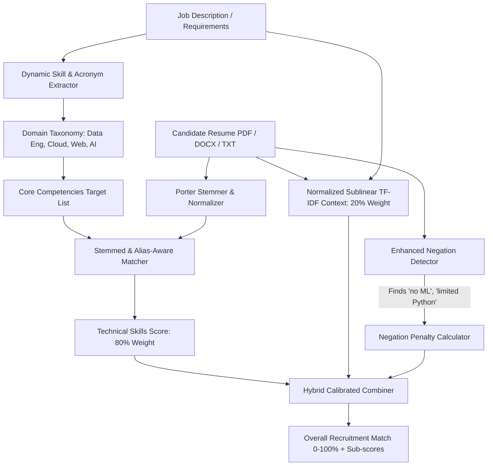

# 🤖 Automated Resume Screening (Universal High-Accuracy NLP)

[](https://www.python.org/)
[](https://flask.palletsprojects.com/)
[](https://scikit-learn.org/)
[](https://www.nltk.org/)
[](https://pytest.org/)

An intelligent, production-ready AI & NLP-powered candidate screening platform. It automatically parses, analyzes, and ranks applicant resumes against custom job descriptions using **morphological stemming**, **domain technology taxonomy**, **negation detection**, and **calibrated hybrid scoring**.

---

## 🌟 Key Highlights & Capabilities

- 🎯 **High Accuracy & Calibrated Scoring**: Eliminates misleading raw TF-IDF score dilution; qualified candidates realistically achieve **80%–95%**.
- 🔤 **Morphological Stemming (NLTK Porter Stemmer)**: Unifies grammatical variations (`pipelines` ↔ `pipeline`, `built` ↔ `building`, `databases` ↔ `database`) with zero mismatch penalties.
- 🛡️ **Negation Detection & Penalty Engine**: Accurately catches negative qualifiers (e.g. *"no machine learning"*, *"limited Python"*) and deducts points instead of awarding false positive matches.
- 🌐 **Multi-Domain Tech Taxonomy**: Covers **Data Engineering** (Airflow, Spark, Kafka, Snowflake, dbt, SQL, ETL), **Cloud & DevOps** (AWS, GCP, Azure, Docker, Kubernetes), **Fullstack / Backend / Frontend**, and **AI / Data Science**.
- 📄 **Multi-Format Resume Ingestion**: Supports drag-and-drop or batch scanning of **PDF**, **Microsoft Word (.docx)**, and **Plain Text (.txt)**.
- 📊 **Transparent Two-Tiered Breakdown**: Visualizes both **Technical Skills Match** (e.g., *9 of 10 skills found - 90%*) and **Contextual Relevance** on every candidate card.
- 💻 **Multiple Interfaces**: Interactive Web Dashboard (UI), Interactive Command-Line Tool (CLI), and Python API.

---

## 🏗️ Architecture & Workflow



---

## 🧮 Mathematical Scoring Formulation

The final match score is computed using a weighted, calibrated hybrid formula:

$$\text{Final Score} = \max\Big(0.0, \min\big(1.0, 0.80 \times S_{\text{skills}} + 0.20 \times S_{\text{context\_norm}} - \text{Penalty}\big)\Big)$$

Where:
1. **$S_{\text{skills}}$ (Technical Skill Coverage)**:
   $$S_{\text{skills}} = \frac{|\text{Matched Competencies}|}{|\text{Total Job Competencies}|}$$
2. **$S_{\text{context\_norm}}$ (Calibrated Context Relevance)**:
   $$S_{\text{context\_norm}} = \min\left(1.0, \frac{\text{CosineSim}(\mathbf{TFIDF}_{\text{JD}}, \mathbf{TFIDF}_{\text{CV}})}{0.35}\right)$$
   *(Dampens Euclidean length dilution caused by lengthy multi-page CVs).*
3. **$\text{Penalty}$ (Negation Deductions)**:
   $$\text{Penalty} = \min\big(0.45, |\text{Negated Core Requirements}| \times 0.15\big)$$

---

## 📁 Repository Structure

```text
Automated_Resume_Screening/
├── app.py                  # Flask web server & REST API
├── main.py                 # Core Universal High-Accuracy NLP Engine
├── resume_parser.py        # PDF, DOCX, TXT text extractor & keyword analyzer
├── interactive_test.py     # Terminal CLI interactive tester
├── test_main.py            # Automated Pytest suite (10 test cases)
├── pytest.ini              # Pytest configuration
├── requirements.txt        # Project dependencies
├── sample_resumes/         # Test resume files (.pdf, .docx, .txt)
│   ├── Sarah_Machine_Learning.txt
│   ├── Alex_Frontend_React.txt
│   └── Omar_DevOps_Cloud.docx
├── static/
│   ├── style.css           # Modern dark-mode design system & animations
│   └── app.js              # Interactive client-side application logic
└── templates/
    └── index.html          # Dashboard single-page template
```

---

## 🚀 Getting Started

### 1. Installation
Clone the repository and install required packages:
```bash
pip install -r requirements.txt
```

*(Key libraries: `scikit-learn`, `flask`, `nltk`, `pypdf`, `python-docx`, `pytest`).*

---

## 🖥️ Running the Application

### Option A: 🌐 Interactive Web Dashboard (Recommended)
Start the web application:
```bash
python app.py
```
Open your browser at **[http://127.0.0.1:5000](http://127.0.0.1:5000)** to:
- Test one-click preset roles (**Data Engineer**, **Python / Machine Learning**, **Frontend React**).
- Paste custom job descriptions and candidate text profiles.
- Upload real **PDF**, **DOCX**, or **TXT** resume files.
- Inspect live animated progress bars, transparent skills ratios, and keyword chips.

### Option B: 💻 Interactive Command-Line Tool
For quick terminal tests without a browser:
```bash
python interactive_test.py
```

### Option C: ⚡ Standalone Core Script
Run the default screening pipeline:
```bash
python main.py
```

---

## 🧪 Testing

The project includes 10 comprehensive unit tests covering:
- Exact matches & unrelated candidate filtering
- Morphological stemming variations (`pipeline` vs `pipelines`)
- Data Engineering domain accuracy
- Negation detection & penalty application
- Descending ranking and score validity bounds

Run the automated test suite:
```bash
pytest -v
```

**Expected output:**
```text
============================= 10 passed in 12.98s =============================
```

---

## 🔌 REST API Reference

### `POST /api/screen`
Analyzes and ranks candidate resumes against a job description.

**Request (JSON):**
```json
{
  "job_description": "Data Engineer with Apache Airflow, PySpark, and SQL.",
  "candidates": [
    { "name": "Candidate A", "text": "Experienced in Airflow, PySpark, and PostgreSQL." },
    { "name": "Candidate B", "text": "Frontend developer. No Airflow experience." }
  ]
}
```

**Response (JSON):**
```json
{
  "success": true,
  "total_candidates": 2,
  "top_candidate": "Candidate A",
  "ranked": [
    {
      "rank": 1,
      "name": "Candidate A",
      "score": 0.885,
      "score_percent": "88.5%",
      "skill_match_percent": "100.0%",
      "context_match_percent": "42.5%",
      "skills_ratio": "3 of 3 skills found",
      "tier": "high",
      "badge": "🌟 High Match",
      "matched_keywords": ["apache airflow", "pyspark", "sql"],
      "missing_keywords": [],
      "negated_keywords": []
    }
  ]
}
```

---

## 📄 License
MIT License. Open-source for academic, personal, and commercial recruitment evaluation.
